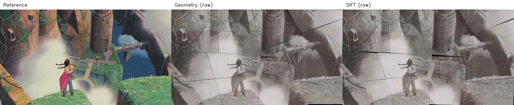
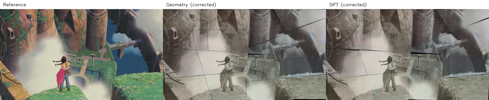

# 第四阶段几何与 SIFT 对比复现记录

日期：2026-11-06。输入来自 compare-sift-geometry 的 28d409f 提交。

## 运行

在仓库根目录安装 requirements.txt 后执行：

```bash
python stage4_assembly/compare_methods.py
python -m unittest discover -s tests -v
```

默认复用已保存的几何位姿和 SIFT 分配，不重新运行两个上游求解器。
全部结果生成于 stage4_assembly/output/method_comparison/。
其 geometry/ 和 sift/ 子目录分别保留原生尺度的第四阶段图像、诊断和人工摆放计划。

## 实际 SIFT 方法

match_sift.py 对实拍 S 碎片和由原图、已知切割布局裁出的 P 模板进行 CLAHE 灰度增强，
提取 SIFT 特征，以 0.75 最近邻距离比过滤匹配，再以 4 px 的 RANSAC 阈值估计单应。
候选分数综合内点数、内点比、变换轮廓与源多边形的 IoU 及重投影误差，
通过匈牙利算法实现 S 到 P 的一一分配。16 片均分配，15 片 accepted，S05 为 review。
这不是不提供原图、也不知道切割布局的一般拼图任务。

## 对比协议

- 同一组 16 片实拍 RGBA，直接渲染到原始参考图的 1280×720 网格。
- 采用同样的预乘 Alpha、目标裁剪、3 px 羽化及强度 0.5 的 Lab 统计校色，分别保留未校色和校色结果。
- 几何方案只增加一个整体外框归一化，方向由参考图辅助选择 180 度，不优化任意单片位姿。
- 几何求解本身不读取参考图；SIFT 匹配读取原图模板及切割布局，并允许单应变形，两者信息和自由度不同。
- 覆盖率按真实变换后 Alpha 支持域统计，黑色不透明像素仍是有效覆盖。
- warped_measured_geometry 使用实测角点变换后的轮廓，不用已知源多边形代替观测。
- target_geometry 是实际渲染使用的裁剪轮廓。SIFT 的该量来自已知切割布局，近 100% 覆盖不能证明匹配正确。
- 几何综合误差是缺口、重叠多计与越界面积之和除以变换后碎片总面积。
- PSNR 包括全画布缺口；另有覆盖区 PSNR。灰度 SSIM 不是色彩恢复率或碎片正确率。
- 原生分辨率报告的指标不与本表混用。校色使用参考图统计，不能视为无参考复原收益。

## 结果

| 指标 | 几何方案 | SIFT 方案 |
| --- | ---: | ---: |
| 真实纹理栅格覆盖率 | 99.625651% | 99.544488% |
| 变换后实测轮廓综合误差 | 0.975267% | 3.079868% |
| 未校色全画布 RGB PSNR | 18.64973 dB | 18.91059 dB |
| 未校色全画布灰度 SSIM | 0.68064 | 0.77145 |
| 校色后全画布 RGB PSNR | 20.45163 dB | 20.95601 dB |
| 校色后全画布灰度 SSIM | 0.68456 | 0.78049 |


本样例 SIFT 的图像相似性较高，几何方案的实测轮廓综合误差较小。
SIFT 的投影轮廓可能越出各自目标，裁剪使输出图像不再显示这些重叠/越界；因此需同时报告未裁剪的实测轮廓误差。
几何仍保留近似解和 S06 复核项；SIFT 还保留 S05 匹配及 S06 轮廓复核项。
SIFT 单应可以含尺度、剪切和透视，其参考像素坐标不能直接作为刚性实物的毫米装配计划。
本组分配没有独立人工真值，不将完成 16/16 分配写作 100% 匹配正确率。





## 环境与验证

```json
{
  "python": "3.12.14",
  "numpy": "2.2.6",
  "opencv": "4.12.0",
  "shapely": "2.1.2",
  "scipy": "1.17.0",
  "scikit_image": "0.25.2"
}
```

88 项全仓测试通过，包含 4 个新增测试：已知像素场的跨尺度坐标映射、不透明黑色的 Alpha 覆盖、已知目标与真实投影几何的区分、实拍两协议端到端对比。
详细数值、配置和输入 SHA256 见 [固定样例报告](STAGE4_METHOD_COMPARISON.json)。生成图像和指标可由上述单条命令重新生成。
