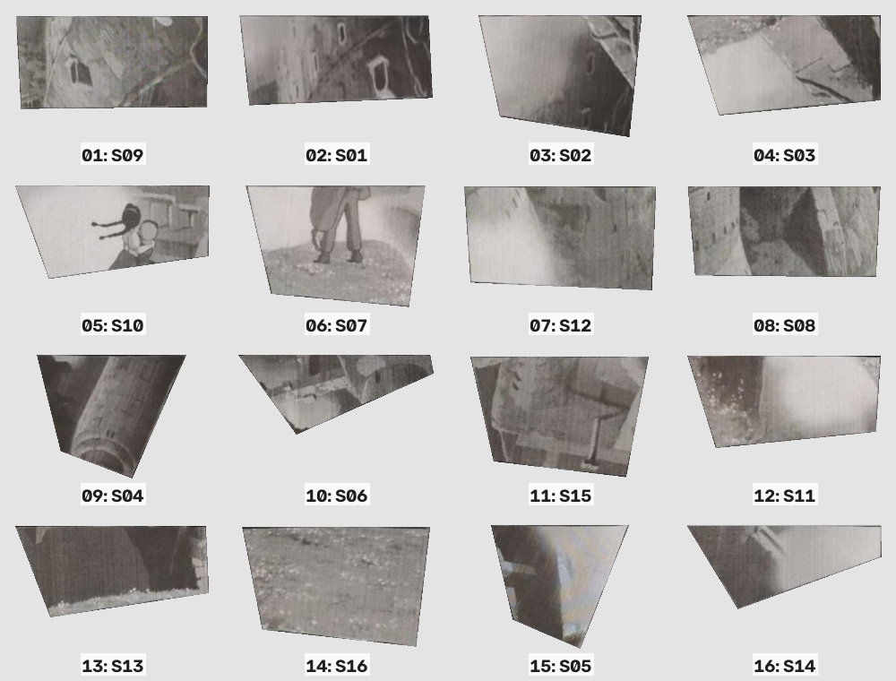
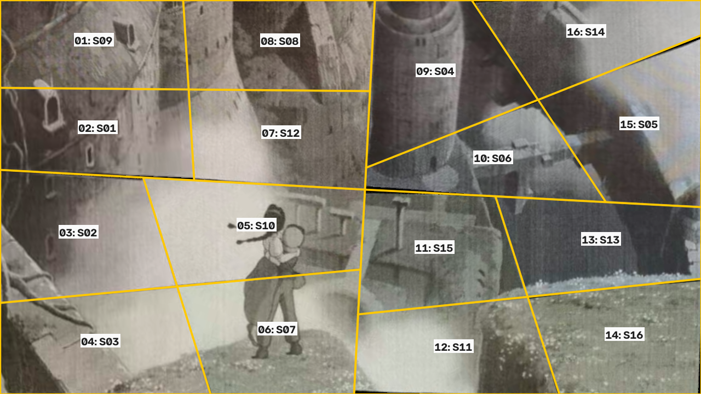
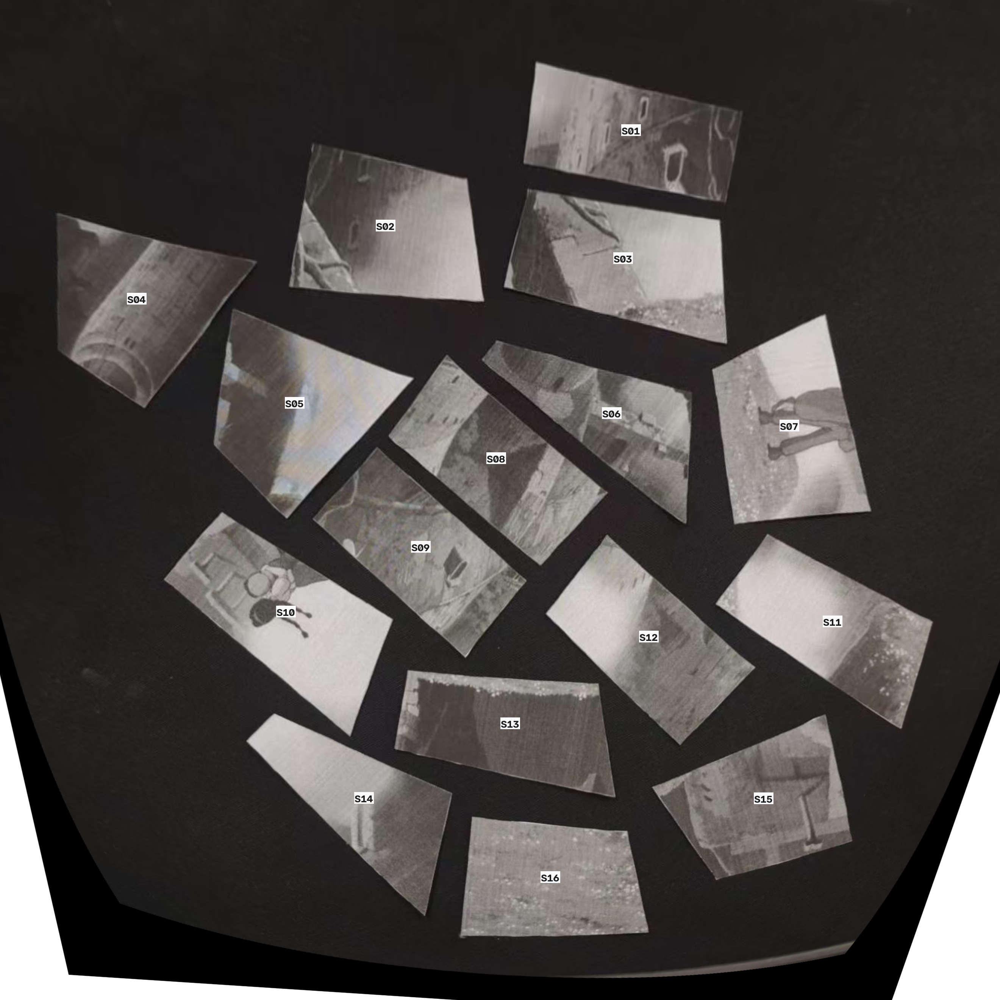

# 人工摆放计划

在空白区域建立目标外框：左上角为原点，x 向右、y 向下。按顺序图及下表逐片摆放。
目标外框的坐标轴与原俯视图坐标轴保持平行；若整体转动外框，表内转角还须叠加该转角。
旋转角以原始俯视照片中该片的朝向为起点；正值顺时针，负值逆时针。先核对取片图中的 S 编号。
原照片中的碎片若已被移动或转动，请重新核对朝向；PNG 的基边方向不是桌面原朝向。

待复核事项：

- S05: upstream manual review required.
- S06: upstream manual review required.

| 步骤 | 取片 | 从原桌面朝向旋转 | 目标中心 (px) | 对齐已放碎片 | 复核 |
| --- | --- | --- | --- | --- | --- |
| 1 | S09 | 逆时针 41.48° | (169.9, 81.3) | 建立锚点 | — |
| 2 | S01 | 顺时针 169.09° | (177.2, 241.1) | S09 | — |
| 3 | S02 | 逆时针 9.67° | (142.0, 431.7) | S01 | — |
| 4 | S03 | 逆时针 13.98° | (182.4, 631.0) | S02 | — |
| 5 | S10 | 顺时针 142.52° | (467.0, 418.8) | S01, S02 | — |
| 6 | S07 | 逆时针 81.29° | (505.3, 608.9) | S03, S10 | — |
| 7 | S12 | 逆时针 40.84° | (511.7, 250.3) | S01, S10 | — |
| 8 | S08 | 逆时针 39.86° | (509.7, 81.7) | S09, S12 | — |
| 9 | S04 | 顺时针 145.91° | (794.3, 136.8) | S12, S08 | — |
| 10 | S06 | 逆时针 34.25° | (898.6, 296.2) | S12, S04 | 需要 |
| 11 | S15 | 逆时针 162.40° | (792.3, 459.8) | S10, S07, S06 | — |
| 12 | S11 | 逆时针 32.69° | (827.1, 641.0) | S07, S15 | — |
| 13 | S13 | 顺时针 170.53° | (1096.4, 445.2) | S06, S15 | — |
| 14 | S16 | 顺时针 174.81° | (1139.0, 619.0) | S11, S13 | — |
| 15 | S05 | 逆时针 40.98° | (1166.1, 233.7) | S06, S13 | 需要 |
| 16 | S14 | 顺时针 134.39° | (1069.0, 65.0) | S04, S05 | — |

角度来自图像平面内的变换；透视单应时，它只是中心附近的近似朝向。不要用数字拼接中的缩放或颜色校正调整实物片形。

黑色缺口是未覆盖区域。参考图只用于整图朝向选择、颜色统计和评价，没有拿原图像素填补缺口。

